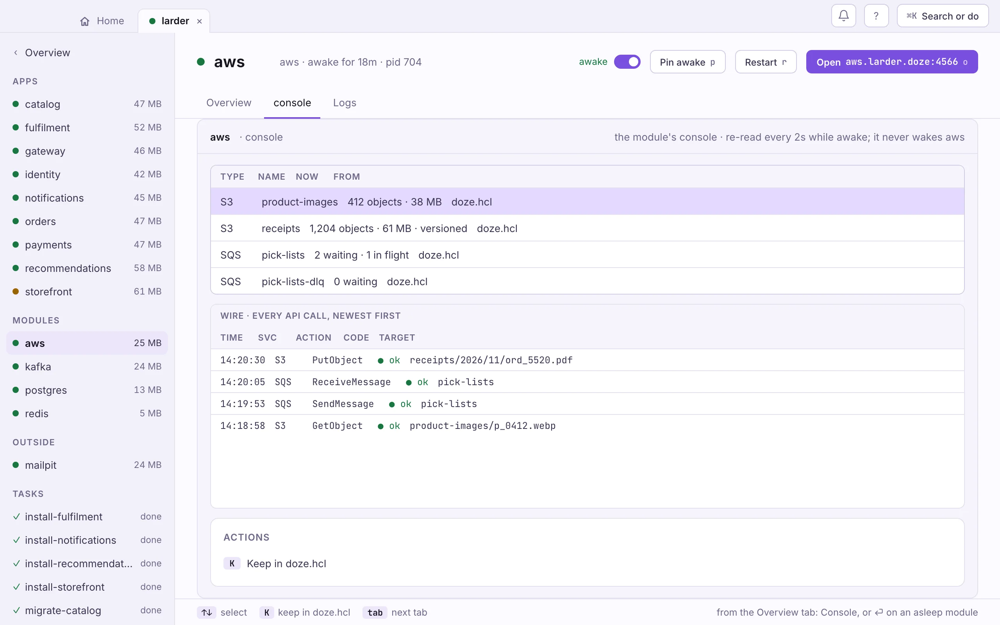

<!-- GENERATED by website/scripts/gen-engines.mjs. The prose between the recipe marks comes from website/src/content/recipes/aws.md; the reference below it from the module's signed registry data. Edit those, not this file. -->

**Runs AWS · macOS and Linux** · [registry page ↗](https://doze-dev.com/registry/doze/aws/)

<!-- recipe:start -->

Run the AWS services your app calls on your machine, with the buckets, queues,
topics and tables declared in doze.hcl, behind one endpoint every AWS SDK
understands.

One `aws` block is one process from the
[doze AWS](https://github.com/doze-dev/doze-aws) project, written in Go: S3,
SQS, SNS, DynamoDB (with Streams), Lambda, EventBridge, KMS, SSM Parameter
Store, Secrets Manager, STS and Step Functions behind one gateway, with a web
console at `/_console`. No Docker, no JVM. It is for building and testing,
not a stand-in for AWS in production.

There is no `version`: the services follow the current AWS APIs.

## The block

Larder, the made-up shop in these docs, keeps product images and receipts in
S3 and hands pick lists to the warehouse over SQS:

```hcl
module aws "aws" {
  port = 4566

  bucket "product-images" {}
  bucket "receipts" { versioning = true }

  queue "pick-lists" {
    dlq          = "auto"
    max_receives = 5
  }
}
```

Everything inside is created when the service first starts, updated when you
change it, and kept on disk across sleeps. `dlq = "auto"` makes a
`pick-lists-dlq` queue and sends a message there after five failed receives.

## Point your SDK at it

```hcl
app "catalog" {
  run  = "go run ./services/catalog"
  port = 8002
  env = {
    AWS_ENDPOINT_URL = module.aws.url
    IMAGES_BUCKET    = "product-images"
  }
}
```

Every current AWS SDK reads `AWS_ENDPOINT_URL`. Resources are plain names.
The SDK still wants credentials and a region; the local services accept any.
From a terminal, `doze env` prints all of it:

```sh
eval "$(doze env aws)"
aws s3 ls
aws sqs get-queue-url --queue-name pick-lists
```

`doze env` exports `AWS_ENDPOINT_URL`, `AWS_ACCESS_KEY_ID`,
`AWS_SECRET_ACCESS_KEY` and `AWS_REGION`.

## Its address

With names on, the service is reached at its name: a block called `aws` in a
stack called `shop` is `http://aws.shop.doze` (with `port` declared, that port
is added). Every name under it reaches it too, so SDKs that put the service or
the bucket in the host work unchanged: `sqs.us-east-1.aws.shop.doze`, and S3 by
virtual host (`uploads.s3.us-east-1.aws.shop.doze`) without
`force_path_style`. `routes = false` keeps it on its port only. See
[Names and addresses](/hcl/names/).

## Queues, topics and fan-out

```hcl
module aws "aws" {
  queue "emails" {
    dlq          = "auto"
    max_receives = 5
  }

  queue "orders.fifo" { fifo = true }

  topic "signups" {
    subscribe {
      queue = "emails"
      raw   = true
    }
  }
}
```

A `subscribe` block in a topic delivers each message to a queue (or a Lambda
or an HTTP endpoint).

## DynamoDB

```hcl
module aws "aws" {
  table "sessions" {
    key = "session_id:S"
    ttl = "expires_at"
  }
}
```

`key` is `"name:type"`, with a sort key after a space: `"pk:S sk:N"`. Streams
are on, so a Lambda can follow a table's changes.

## Lambda and EventBridge

```hcl
module aws "aws" {
  function "resize" {
    code    = "./functions/resize"
    timeout = 10
  }

  rule "order-placed" {
    pattern = "{\"source\":[\"shop.checkout\"]}"
    targets = ["lambda:resize", "queue:emails"]
  }
}
```

`code` is a folder with a `bootstrap` executable (the `provided.al2`
runtime); the function runs as a local process. `PutEvents` on the default
bus delivers to every rule whose pattern matches.

## Keys, parameters and secrets

```hcl
module aws "aws" {
  key "app" {}
  parameter "/app/feature/banner" { value = "on" }
  secret "db-password" { value = "local-only" }
}
```

## The console

`/_console` on the service's address has a page per service: browse buckets
and objects, peek at and purge queues, scan tables, invoke functions. Its
Traffic tab shows every API call your app makes. In the app it is the
service's Console tab.



<!-- recipe:end -->

## Reference

Every doze-aws service — S3, SQS, SNS, DynamoDB, Lambda, EventBridge, Step Functions, Kinesis, API Gateway, CloudFormation, IAM, KMS, SSM, Secrets Manager, STS — behind one gateway on one endpoint, as one doze instance. Declare buckets, queues, topics, tables, functions, rules, keys, secrets, parameters and state machines as nested blocks (the same resource graph doze-aws compiles a CloudFormation template down to); doze converges them on boot. A stock SDK or the aws CLI points AWS_ENDPOINT_URL at the one endpoint; the web console at /_console manages everything, with the live Flows graph and a Traffic tail capturing every call. One process, no Docker, no JVM, no LocalStack.

### Every field at once

<!-- ground:skip -->
```hcl
module aws "local" {
  port = 4566

  bucket "uploads" { versioning = true }
  queue  "emails" {
    dlq = "auto"
    max_receives = 5
  }
  queue  "orders" {
    fifo = true
    content_dedup = true
  }

  topic "signups" {

    subscribe {

    queue = "emails"

    raw = true

  }
  }

  table "sessions" {
    key = "session_id:S"
    ttl = "expires_at"
  }

  function "resize" {
    code    = "./functions/resize"   # dir with a provided.al2 bootstrap
    timeout = 10
  }

  rule "order_placed" {
    pattern = "{\"source\":[\"shop.checkout\"]}"
    targets = ["lambda:resize", "queue:emails"]
  }

  key "app_key" {}
  secret "db_password" { value = "s3cr3t" }
  parameter "/app/feature/banner" { value = "hello" }

  state_machine "order_flow" {
    definition = <<-ASL
      {
        "StartAt": "Resize",
        "States": {
          "Resize": {
            "Type": "Task",
            "Resource": "arn:aws:lambda:us-east-1:000000000000:function:resize",
            "Retry": [{"ErrorEquals": ["States.TaskFailed"], "MaxAttempts": 2}],
            "Next": "Notify"
          },
          "Notify": {
            "Type": "Task",
            "Resource": "arn:aws:states:::sqs:sendMessage",
            "Parameters": {"QueueUrl": "http://localhost:4566/000000000000/emails", "MessageBody.$": "$"},
            "End": true
          }
        }
      }
    ASL
  }
}
```

### Versions

This engine takes no `version =`: it tracks current APIs.

### Fields

_This engine has no top-level fields of its own._
Every module block also takes doze's own fields: `port`, `listen`, `sleep`,
`after`, `enabled`, `routes`, `count` and `for_each`
([doze.hcl reference](/reference/doze-hcl/)).

### Nested blocks

**`bucket "<name>" { … }`** — One S3 bucket (the label is the bucket name).

| Field | Type | Default | Description |
|---|---|---|---|
| `versioning` | bool | `false` | Enable object versioning. |
| `object_lock` | bool | `false` | Enable object lock (implies versioning). |

**`queue "<name>" { … }`** — One SQS queue; dlq = "auto" creates and wires a dead-letter companion.

| Field | Type | Default | Description |
|---|---|---|---|
| `fifo` | bool | `false` | FIFO queue (name gets .fifo). |
| `dlq` | string | — | "auto" or an existing queue name. |
| `max_receives` | number | — | Receives before dead-lettering. |

**`topic "<name>" { … }`** — One SNS topic with subscribe blocks (queue/lambda/http, filter, raw).

_No fields: the label is the declaration._

**`table "<name>" { … }`** — One DynamoDB table; key uses the "pk:S sk:N" shorthand, plus gsi/lsi blocks.

_No fields: the label is the declaration._

**`function "<name>" { … }`** — One Lambda function running as a real local process (code = local dir).

_No fields: the label is the declaration._

**`rule "<name>" { … }`** — One EventBridge rule; targets use "queue:name"/"topic:name"/"lambda:name".

_No fields: the label is the declaration._

**`key "<name>" { … }`** — One KMS key with real local crypto.

_No fields: the label is the declaration._

**`secret "<name>" { … }`** — One Secrets Manager secret (never stomped without force).

_No fields: the label is the declaration._

**`parameter "<name>" { … }`** — One SSM parameter (the label is the full /path).

_No fields: the label is the declaration._

**`state_machine "<name>" { … }`** — One Step Functions state machine, run locally against the stack's functions, queues and topics.

| Field | Type | Default | Description |
|---|---|---|---|
| `definition` | string | — | The States Language document — a heredoc, or file("./flow.asl.json"). **Required.** |
| `role` | string | — | Role ARN; the API requires one and nothing local evaluates it, so it defaults. |
| `type` | string | `STANDARD` | STANDARD or EXPRESS (Express executions arrive after Standard ones). |

### Module releases

The releases of the module that provide this engine. doze picks the newest
one that fits your doze and your `version =`, and pins it in `doze.lock`;
you never write these. Older releases stay available for pinned lockfiles.

| Release | Engine versions | Platforms | |
|---|---|---|---|
| `0.2.0` |  | 3 | **stable** |
| `0.1.1` |  | 3 |  |
| `0.1.0` |  | 3 |  |

Signed data: [index.yaml ↗](https://registry.doze-dev.com/doze/aws/index.yaml) · [meta.yaml ↗](https://registry.doze-dev.com/doze/aws/meta.yaml)
