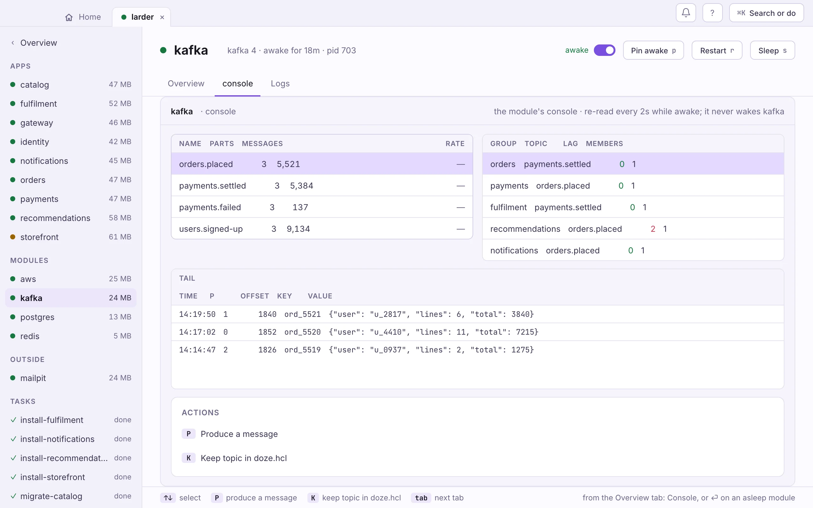

<!-- GENERATED by website/scripts/gen-engines.mjs. The prose between the recipe marks comes from website/src/content/recipes/kafka.md; the reference below it from the module's signed registry data. Edit those, not this file. -->

**Runs Kafka 1 – 4 · macOS and Linux** · [registry page ↗](https://doze-dev.com/registry/doze/kafka/)

<!-- recipe:start -->

Run a Kafka broker for your producers and consumers, with the topics declared
in doze.hcl and a console to watch them.

Kafka itself runs on the JVM, and the usual local answer is Docker and a
gigabyte of images. This module is a single-node broker written in Go, from
the [doze Kafka](https://github.com/doze-dev/doze-kafka) project. It speaks the
Kafka wire protocol, with consumer groups (classic and KIP-848), compaction and
retention, so any Kafka client connects to it. It is for building and testing,
not a production cluster.

`version` is the Kafka protocol profile your clients expect (1 to 4), not a
broker build.

## Topics

```hcl
module kafka "events" {
  version            = 4
  auto_create_topics = false

  topic "orders" { partitions = 3 }
  topic "payments" {
    config = { "cleanup.policy" = "compact" }
  }
}
```

Declared topics are created on the broker's first start. Larder, the made-up
shop in these docs, sets `auto_create_topics = false`: its topics are the
contracts between services, so they are declared rather than created by
whichever client writes first. Leave it on, and `default_partitions` and
`retention` apply to topics clients create.

## Connect a client

A broker's reference is `.address`, the host and port a client bootstraps
from:

```hcl
app "emailer" {
  run = "go run ./cmd/emailer"
  env = { KAFKA_BROKERS = module.events.address }
}
```

```go
cl, _ := kgo.NewClient(
	kgo.SeedBrokers(os.Getenv("KAFKA_BROKERS")),
	kgo.ConsumerGroup("emailer"),
	kgo.ConsumeTopics("orders"),
)
```

From a terminal, with [kcat](https://github.com/edenhill/kcat):

```sh
doze url events
# events.shop.doze:9092
kcat -b "$(doze url events)" -t orders -P <<< '{"order":1}'
kcat -b "$(doze url events)" -t orders -C -o beginning
```

The broker wakes on the first connection. A consumer keeps its connection
open, so a stack with a running consumer keeps Kafka awake, which is what you
want. An app that only consumes Kafka gets no requests of its own, so give it
`sleep = "never"`, as Larder does for `orders` ([Sleep and wake](/hcl/sleep/)).

## The console

The broker serves a web console one port above its own (`9093` for a broker
on `9092`): topics with a live tape of messages, a produce panel, offsets per
partition, and consumer groups with their lag. In the app it is the service's
Console tab.



<!-- recipe:end -->

## Reference

A local, disk-backed broker that speaks enough of the Kafka wire protocol that unmodified clients (franz-go, kcat, Sarama, the Java client) connect and work. No JVM, no ZooKeeper, no KRaft — the engine is doze-kafka, embedded in the module, and `version` selects the Kafka protocol profile it advertises (1–4). Declare topics and doze converges them on boot; auto-create handles the rest.

### Every field at once

<!-- ground:skip -->
```hcl
module kafka "events" {
  version = 4
  port    = 9092

  auto_create_topics = true
  default_partitions = 1
  retention          = "168h"

  topic "orders" {
    partitions = 3
  }
  topic "payments" {
    partitions = 1
    config = { "cleanup.policy" = "compact" }
  }
}
```

### Versions you can declare

The `version =` you write is the engine's own version. doze fetches and
verifies it, pins it in `doze.lock`, and picks the module release that
provides it.

`1` · `2` · `3` · `4`

### Fields

| Field | Type | Default | Description |
|---|---|---|---|
| `version` | number | — | Advertised Kafka protocol profile — 1, 2, 3, or 4. **Required.** |
| `auto_create_topics` | bool | `true` | Create unknown topics on first reference. |
| `default_partitions` | number | `1` | Partition count for auto-created topics. |
| `retention` | string | — | Delete segments older than this (Go duration, e.g. "168h"); empty = unbounded. |
| `retention_bytes` | number | — | Delete old segments once a partition exceeds this size (0 = unbounded). |

Every module block also takes doze's own fields: `port`, `listen`, `sleep`,
`after`, `enabled`, `routes`, `count` and `for_each`
([doze.hcl reference](/reference/doze-hcl/)).

### Nested blocks

**`topic "<name>" { … }`** — A topic to create on boot.

| Field | Type | Default | Description |
|---|---|---|---|
| `partitions` | number | `1` | Partition count. |
| `config` | map(string) | — | Per-topic config (e.g. cleanup.policy = compact). |

### Module releases

The releases of the module that provide this engine. doze picks the newest
one that fits your doze and your `version =`, and pins it in `doze.lock`;
you never write these. Older releases stay available for pinned lockfiles.

| Release | Engine versions | Platforms | |
|---|---|---|---|
| `0.1.2` | 1 · 2 · 3 · 4 | 3 | **stable** |
| `0.1.1` | 1 · 2 · 3 · 4 | 3 |  |
| `0.1.0` | 1 · 2 · 3 · 4 | 3 |  |

Signed data: [index.yaml ↗](https://registry.doze-dev.com/doze/kafka/index.yaml) · [meta.yaml ↗](https://registry.doze-dev.com/doze/kafka/meta.yaml)
